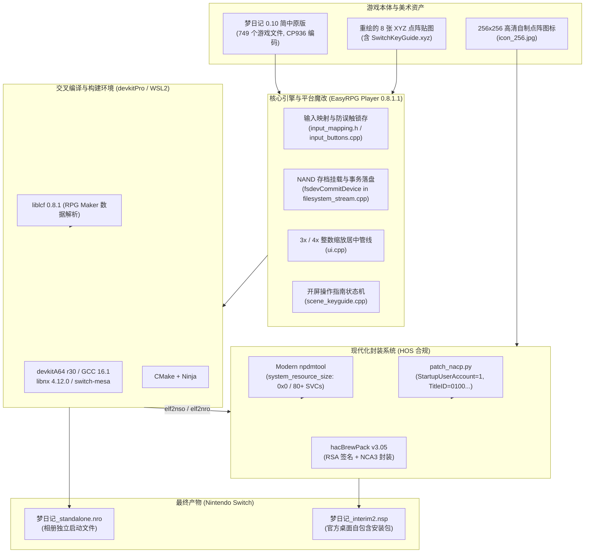

# 《梦日记》(Yume Nikki) Nintendo Switch 移植项目·核心接手与全景开发文档

> **文档性质**：项目交接 / 快速上手 / 架构设计与工程维护全景指南 (Handover & Engineering Guide)  
> **面向对象**：后续接手本项目的 AI 对话会话、人类开发者与维护者  
> **当前版本**：v1.0.0 (Release Candidate / 生产就绪版本)  
> **维护状态**：已解决所有早期构建缺陷（如无法启动、键位误触、掉电丢档等），处于稳定维护期  

---

## 目录 (Table of Contents)

1. [项目概览与交付物速查 (Executive Summary)](#1-项目概览与交付物速查-executive-summary)
2. [项目全景架构与技术栈 (System Architecture & Tech Stack)](#2-项目全景架构与技术栈-system-architecture--tech-stack)
3. [四大核心定制机制深度解析 (Deep-Dive into Custom Features)](#3-四大核心定制机制深度解析-deep-dive-into-custom-features)
   - [3.1 官方机身 NAND 账户独立存档体系（方案 A / 零 SD 污染）](#31-官方机身-nand-账户独立存档体系方案-a--零-sd-污染)
   - [3.2 Switch 掌机手柄按键体系与双向防误触锁存架构](#32-switch-掌机手柄按键体系与双向防误触锁存架构)
   - [3.3 原生等比整数点阵缩放与纯黑填充管线](#33-原生等比整数点阵缩放与纯黑填充管线)
   - [3.4 全量点阵美术与开屏操作指南贴图重绘](#34-全量点阵美术与开屏操作指南贴图重绘)
4. [工作区目录全景与文件整理索引 (Workspace Tour)](#4-工作区目录全景与文件整理索引-workspace-tour)
5. [完整构建、测试与打包流水线 (Build & Packaging Pipeline)](#5-完整构建测试与打包流水线-build--packaging-pipeline)
   - [5.1 基础环境准备](#51-基础环境准备)
   - [5.2 一键构建流水线 (build_nsp_v3.sh)](#52-一键构建流水线-build_nsp_v3sh)
   - [5.3 单元测试运行方法](#53-单元测试运行方法)
   - [5.4 补丁更新与维护规范](#54-补丁更新与维护规范)
6. [排错指南与已知陷阱 (Troubleshooting & Known Pitfalls)](#6-排错指南与已知陷阱-troubleshooting--known-pitfalls)
7. [后续接手开发者 / AI 会话行动清单 (Developer Action Checklist)](#7-后续接手开发者--ai-会话行动清单-developer-action-checklist)

---

## 1. 项目概览与交付物速查 (Executive Summary)

### 1.1 项目定位
本项目是将 RPG Maker 2003 著名殿堂级独立游戏**《梦日记》（Yume Nikki 0.10 简体中文汉化版）**深度原生移植到 **Nintendo Switch (HOS 18/19/20+ / Atmosphère)** 平台的自包含移植工程。

本项目**彻底抛弃了过时的 RetroArch 前端、Wine-NX 兼容层以及旧版 Nro2Nsp 的简易 Forwarder**，而是通过在源码层深度定制开源解释器 **EasyRPG Player**，打造了一个**具有官方商业游戏同等交互品质**的独立 NSP：
- 规范的标准商业段 Title ID（`0100A1B2C3D40000`）。
- 启动时自动拉起 Switch 官方“由谁游玩？”账户选择器。
- 游戏存档与配置全量走机身 NAND 加密存档分区（`save:/`），带事务日志提交保护，不向 SD 卡产生任何脏文件。
- 原生 3× / 4× 绝对等比整数点阵居中缩放，纯正像素观感。
- 完备的手柄防误触锁存机制与全量重绘的原生点阵手柄教学贴图。

### 1.2 核心交付产物速查

所有最终二进制构建产物均规范归档于 `dist/` 目录下：

| 文件名 | 大小 | SHA-256 校验和 | 交付定位与说明 |
|:---|:---|:---|:---|
| **`dist/梦日记_interim2.nsp`** | 50.7 MB | `74c31b028c6d5817c721a570cd82e58d7bbaaaec8744a89117b5b504792aef8f` | **主力交付物**：现代化官方级自包含 NSP，支持 DBI 直接安装到 Switch 桌面，含机身 NAND 存档、多用户隔离与桌面图标。 |
| **`dist/梦日记_standalone.nro`** | 55.8 MB | `01711eb658c84a424aca01fc2cc4d90660bcc5590280210cfb5dd502391a77f5` | **备用交付物**：免安装单文件 NRO，放入 TF 卡 `/switch/` 通过相册 hbmenu 直接运行。 |
| `dist/梦日记-nx.zip` | 49.3 MB | - | 分发压缩归档包（内含 NSP 及说明）。 |
| `dist/RELEASE_NOTES_v1.0.0.md` | - | - | 正式版本发布说明与安装指引。 |

> [!TIP]
> **快速测试建议**：如果您要在实机上测试或交付，只需取用 `dist/梦日记_interim2.nsp`，通过 DBI 的 MTP 模式拖拽到 Switch 的 `MicroSD install` 或 `NAND install` 即可直接安装运行。

---

## 2. 项目全景架构与技术栈 (System Architecture & Tech Stack)

### 2.1 系统架构图



### 2.2 核心技术组件选型与版本

| 组件 | 版本 | 说明 |
|:---|:---|:---|
| **游戏宿主** | RPG Maker 2003 1.0.9.1 | 《梦日记》0.10 简体中文版，文本字符集为 CP936 / GBK，自带完整素材无需外部 RTP |
| **移植引擎** | EasyRPG Player 0.8.1.1 | 开源 RPG Maker 解释器，应用了本项目定制的 37KB 补丁包 |
| **数据库** | liblcf 0.8.1 | 解析 `.ldb`、`.lmt`、`.lmu` 格式的核心库 |
| **交叉编译器** | devkitA64 r30 (GCC 16.1.0) | devkitPro 官方 64 位 ARM 工具链 |
| **Switch 核心库** | libnx 4.12.0 | Nintendo Switch 官方自制软件核心接口库 |
| **图形/渲染库** | switch-mesa 20.1.0 / glad 0.1.27 | 硬件加速渲染管线（EGL / OpenGL） |
| **音频后端** | mpg123 + dr_wav + FmMidi | 覆盖原版 8 个 MP3、49 个 WAV 与 8 个 MIDI |
| **NSP 封装器** | hacBrewPack v3.05 | 替代了旧版 Nro2Nsp 的旧工具，提供完整的 RSA 配对签名与 modern NCA 封装 |

---

## 3. 四大核心定制机制深度解析 (Deep-Dive into Custom Features)

### 3.1 官方机身 NAND 账户独立存档体系（方案 A / 零 SD 污染）

#### 3.1.1 为什么必须采用官方 NAND 方案？
在早期版本或常规移植中，游戏通常把存档写在 SD 卡（例如 `sdmc:/switch/yumenikki-nx/save/`）。这种方式有严重缺陷：
1. **多用户混淆**：Switch 主机上多个玩家档案会共用同一套存档文件，互相覆盖。
2. **SD 卡文件碎片与拔卡风险**：玩家拔出 SD 卡在电脑读取时可能误删存档。
3. **系统无法统一管理**：在 Switch 的“系统设置 -> 数据管理 -> 管理保存数据”中看不到该游戏的存档大小，也无法使用系统自带的数据清除与云备份机制。

#### 3.1.2 实现细节与代码注入点

1. **强制拉起系统账户选择器 (`patch_nacp.py`)**：
   在打包生成的 `control.nacp` 中，配置以下属性：
   - `StartupUserAccount = 1 (Required)`：每次在 Switch 桌面启动游戏时，OS 强制弹出“由谁游玩？”头像选择界面。
   - `SaveDataOwnerId = 0x0100A1B2C3D40000`
   - `UserAccountSaveDataSize = 16 MiB`，`UserAccountSaveDataJournalSize = 16 MiB`（配额上限各 32 MiB）。
2. **挂载机身 NAND 存档分区 (`src/platform/switch/main.cpp`)**：
   使用 libnx 的 `fsMount_SaveData(&save_fs, title_id, user_id)` 将当前所选用户的 NAND 专属存档容器挂载为虚存设备 `"save"`（路径即为 `save:/`）。
3. **关键：事务日志提交机制 (`fsdevCommitDevice("save")`)**：
   > [!IMPORTANT]
   > Switch 的机身 NAND 存档采用了严格的日志型事务文件系统（Journaled Filesystem）。**在关闭文件句柄（fclose）后，数据仅仅写入了内存缓冲区，如果不显式调用 `fsdevCommitDevice("save")`，一旦游戏异常退出或玩家按 HOME 键强制关闭软件，所有修改将直接回滚丢弃！**

   本项目在以下三处核心节点注入了强制提交逻辑：
   - **`src/filesystem_stream.cpp`**：在 `Filesystem_Stream::OutputStream::Close()` 析构关闭文件流时，自动检查并执行 `fsdevCommitDevice("save")`。这意味着每次游戏写日记保存、修改配置文件落盘后，立即硬提交到 NAND！
   - **`src/scene_save.cpp`**：保存界面写完存档后额外提交一次。
   - **`src/scene_settings.cpp`**：修改音量或渲染配置后提交。
   - **`src/platform/switch/main.cpp`**：在主程序收到退出信号时统一提交并安全卸载设备。
4. **彻底关闭 SD 日志写入 (`src/game_config.cpp`)**：
   Switch 平台默认设置 `log_enabled = false`，禁止生成日志文件，确保零 SD 写入，彻底消除 SD 卡依赖。

---

### 3.2 Switch 掌机手柄按键体系与双向防误触锁存架构

#### 3.2.1 物理手柄按键映射表

《梦日记》原版在 PC 上依赖键盘的 `ENTER`、`ESC`、`SHIFT`、`1`、`3`、`5`、`9` 等按键。针对 Switch 掌机及 Pro 手柄，定制了完全符合现代主机习惯的映射布局：

| Switch 手柄按键 | 原作键位 | 映射游戏动作 | 逻辑说明与操作场景 |
|:---|:---|:---|:---|
| **左摇杆 / 十字键** | 方向键 | 移动 / 光标导航 | 控制附子上下左右移动与菜单选择 |
| **A 键** | ENTER / Z | 调查 / 决定 (`DECISION`) | 调查房间家具、对话、书桌写日记保存 |
| **B 键** | ESC / X | 取消 / 返回 (`CANCEL`) | 取消选择、退出小游戏、关闭物品栏 |
| **Plus (+) 键** | ESC | **呼出游戏菜单 (`CANCEL`)** | 随时开启/关闭梦日记效果物品栏菜单 |
| **R 键** | SHIFT | **奔跑 / 加速 (`SHIFT`)** | 骑自行车加速或特殊奔跑 |
| **X 键** | 数字键 9 | **捏脸醒来 (`N9`)** | 掐附子的脸，从梦境脱离回到现实房间 |
| **Y 键** | 数字键 5 | **丢弃效果 (`N5`)** | 在门的房间内丢弃当前装备的效果道具 |
| **L + A** | 数字键 1 | **效果特殊动作 1 (`N1`)** | 触发当前装备效果的主动作（如开伞、红绿灯变色等） |
| **L + B** | 数字键 3 | **效果特殊动作 2 (`N3`)** | 触发当前装备效果的次动作 |
| **ZR 键** | - | 快进游戏 (`FAST_FORWARD_A`) | 按住后以多倍速快进探索节奏 |
| **Minus (-) 键** | - | **EasyRPG 系统设置菜单** | 调整全局音量、音频渲染器配置 |
| **ZL / 摇杆下压** | - | *已禁用* | 屏蔽无用按键，防止探索中误触 |

#### 3.2.2 双向防误触锁存算法 (`ModifierState`)

针对组合键（`L + A`、`L + B`）可能出现的“串键”问题（例如：想按 `L + A` 触发效果动作，结果误触发了 A 键的调查；或者松开时先松开了 L，导致误判定为单独按 A），在 `src/platform/switch/input_mapping.h` 中实现了精确的带状态锁存算法：

```cpp
struct ModifierState {
    // 释放 L 锁存：按住 L 时按下的 A/B，在松开 L 但未松开 A/B 时，继续抑制普通 A/B
    bool suppress_normal_a = false;
    bool suppress_normal_b = false;

    // 按下 L 锁存：在未按 L 时已按住的 A/B，后续若不小心按到了 L，抑制组合键 N1/N3
    bool suppress_chord_a = false;
    bool suppress_chord_b = false;
};
```

**锁存器工作流程：**
1. **防提前触发普通键**：只要 `L` 被按住，独立的 A 键和 B 键动作被硬屏蔽。
2. **防松手漏键（释放锁存）**：触发 `L + A` 后，若玩家先松开 `L` 手指尚未离开 `A`，系统检测到 `suppress_normal_a` 为 true，不会误触发 A 的调查动作；直到 A 键完全抬起，状态机才复位。
3. **防误碰组合键（按下锁存）**：如果玩家正在按住 A 调查对话，中途不小心按到了 L，系统检测到 `suppress_chord_a` 为 true，绝不会误触发 N1 技能。

该算法在 `tools/tests/test_input_mapping.cpp` 中拥有 100% 覆盖率的主机端单元测试。

---

### 3.3 原生等比整数点阵缩放与纯黑填充管线

#### 3.3.1 渲染原则
- **游戏原生分辨率**：320×240 (4:3 比例)。
- **掌机模式 (720p, 1280×720)**：采用严格 **3× 等比整数缩放（960×720）**，居中渲染。
- **底座模式 (1080p, 1920×1080)**：采用严格 **4× 等比整数缩放（1280×960）**，居中渲染。
- **背景填充**：四周填充纯黑色（#000000），消除一切拉伸模糊、锯齿插值形变。
- **锁定触屏面板**：移动端专用的虚拟数字键盘和触摸操控已在底层被硬编码禁用（`touch_ui = false`），保证画面的纯粹性。

---

### 3.4 全量点阵美术与开屏操作指南贴图重绘

为了让 Switch 玩家获得官方发售级别的沉浸感，本项目全量重绘了游戏内部包含的所有按键操作说明贴图（全部转换为 RPG Maker 原生 XYZ 调色板点阵格式）：

#### 3.4.1 重绘贴图清单表 (`work/patched_picture/`)

| 贴图文件名 | 原始贴图作用 | 重绘内容与 Switch 实体按键适配 |
|:---|:---|:---|
| **`SwitchKeyGuide.xyz`** | **本项目新增** | **开屏专属操作指南**（点“开始梦境”时最先呈现，展示全手柄按键对照） |
| `GameFlow.xyz` | 梦境操作总览 | 修改为 `A 调查`、`B 取消`、`X 捏脸醒来`、`Y 丢弃效果`、`L+A 特殊动作` 等 |
| `indream.xyz` | 梦境中操作图解 | 替换原版键盘按键为 Switch 彩色 Joy-Con 按键图标 |
| `FCgameflow.xyz` | FC 风格世界操作指南 | 适配 FC 像素风格的点阵 Switch 按键 |
| `FCindream.xyz` | FC 梦境中操作图解 | 适配 FC 像素风格的动作按键说明 |
| `FamiGameIntro.xyz` | NASU 电视机小游戏介绍 | 提示使用十字键与 A 键吃茄子 |
| `[G]frame.xyz` | NASU 游戏主界面外边框 | 下方原版键盘按键指引全量重绘为 Switch 手柄提示 |
| `[G1]Title.xyz` | NASU 游戏标题画面 | 提示按 A 开始游戏 |

#### 3.4.2 字体与美术工艺规范
- **字形规范**：采用严格的 **1-bit Mono 丁卯点阵体**（10px 规格，汉字使用 9×9 像素点阵无损对齐）。
- **描边工艺**：完全继承原版作者 ききやま 的三色渐变欧式暗色描边，与游戏原生 UI 完美融合。
- **场景挂载机制**：在 EasyRPG 状态机中新增 `Scene_KeyGuide`（`src/scene_keyguide.cpp`），在标题界面选择“开始梦境”后无缝切入，玩家按 A 键或 B 键后平滑进入主角房间。

---

## 4. 工作区目录全景与文件整理索引 (Workspace Tour)

工作区核心根目录为 `d:\YumeNikki-Nx\`，内部组织清晰严整：

```text
d:\YumeNikki-Nx\
├── HANDOVER.md                                 # 本接手文档 (全局核心引导)
├── README.md                                   # 项目主说明文档 (含特性、按键与安装指引)
├── .gitignore                                  # 生产级 Git 忽略规则 (过滤 Keys、构建中间物与大包)
├── keys/
│   └── prod.keys                               # Switch 官方打包密钥 (用于本地 hacBrewPack 签名，严禁上传公网)
├── patches/
│   └── easyrpg-player-yumenikki-nx.patch       # EasyRPG 0.8.1.1 完整定制补丁 (37KB)
├── tools/
│   ├── build_nsp_v3.sh                         # 主力自动化全流程构建与打包脚本 (一键编译+生成 NSP/NRO)
│   ├── build_npdm.py                           # HOS 20+ 合规的 NPDM JSON 描述符构建脚本
│   ├── patch_nacp.py                           # NACP 官方机身 NAND 账户存档属性修补工具
│   ├── test_npdm.py                            # NPDM 静态格式验证辅助脚本
│   ├── build_v2.sh                             # 历史版本打包脚本 (供参考)
│   ├── tests/
│   │   └── test_input_mapping.cpp              # SwitchInput::ApplyPad 双向锁存防误触单元测试
│   └── Nro2Nsp-master/                         # 历史早期打包工具包 (已退役，保留备查)
├── docs/
│   ├── 对话记录导出.md                           # 历史技术决策与问题攻坚完整时间线记录
│   └── Nintendo Switch Homebrew...指南.md       # 早期移植技术路线调研与可行性分析报告
├── dist/                                       # 编译构建输出归档目录
│   ├── 梦日记_interim2.nsp                      # 最新 Release NSP (推荐安装)
│   ├── 梦日记_standalone.nro                    # 最新 Release 独立免安装 NRO
│   ├── 梦日记_interim1.nsp                      # 历史 Interim1 测试包
│   ├── 梦日记-nx.zip                            # 发布分发压缩包
│   ├── RELEASE_NOTES_v1.0.0.md                 # v1.0.0 发布说明
│   ├── README_interim1.md                      # Interim1 测试指引与冒烟清单
│   └── README_interim2.md                      # Interim2 修复项与安装说明
├── work/                                       # 工作暂存与源码定制区
│   ├── icon_256.jpg                            # 256x256 高清点阵游戏图标
│   ├── patched_picture/                        # 重绘后的 8 张 Switch 专用 XYZ 贴图资产
│   ├── src/                                    # 修改后的 EasyRPG Player 与 liblcf 源码副本 (用于生成 patch)
│   └── game/                                   # staged 游戏文件副本
├── build/                                      # 桌面端调试脚本与中间文件
│   ├── env.sh                                  # 环境变量配置
│   ├── run_host_test.sh                        # Linux 桌面端 Xvfb 自动化运行测试脚本
│   └── source-manifest.csv                     # 游戏 749 个文件的校验清单表
├── vendor/                                     # 上游干净源码包解压目录 (用于 git diff 校验)
│   ├── easyrpg-player-0.8.1.1/
│   └── liblcf-0.8.1/
└── yumenikki0.10chs/                           # 梦日记 0.10 简体中文版原始游戏未修改根资产
```

---

## 5. 完整构建、测试与打包流水线 (Build & Packaging Pipeline)

### 5.1 基础环境准备

本项目采用 **Windows 宿主机 + WSL2 (Ubuntu 24.04 LTS)** 的混合协同模式：
- **代码与资产存放**：Windows 文件系统 `D:\YumeNikki-Nx`（在 WSL2 中自动映射为 `/mnt/d/YumeNikki-Nx`）。
- **工具链配置（WSL2 内）**：
  - `/opt/devkitpro`（devkitPro 官方工具链，包含 `devkitA64`、`libnx`、`switch-tools`、`switch-mesa` 等）。
  - `/opt/easyrpg-switch`（已预编译好供 Switch 链接的 ICU、liblcf、fmt、mpg123、dr_wav 静态库）。
  - 打包工具：`/home/ubuntu/yn-build/tools/hacbrewpack_src/hacBrewPack-master/hacbrewpack`。

### 5.2 一键构建流水线 (`build_nsp_v3.sh`)

整个编译、单测、打包和归档已经完全自动化。在 WSL2 或通过 PowerShell 执行以下命令即可完成全量构建：

```powershell
# 在 Windows PowerShell 中直接调用 WSL 构建：
wsl bash /mnt/d/YumeNikki-Nx/tools/build_nsp_v3.sh
```

#### 流水线五个阶段的执行细节：

1. **`[0/5] 资产与源码同步 (Syncing assets & patching NACP)`**：
   - 将 `work/src/` 中的魔改源码同步到 WSL 构建目录。
   - 将 `work/patched_picture/*.xyz` 重绘贴图复制到 RomFS 的 `Picture/` 目录下。
   - 将 `work/icon_256.jpg` 分发到 AmericanEnglish、SimplifiedChinese、TraditionalChinese 控制图标槽位。
   - 执行 `patch_nacp.py`，向 `control.nacp` 注入 `StartupUserAccount = 1` 及 16MB NAND 存档配额。
2. **`[1/5] 主机端单测运行 (Running host unit tests)`**：
   - 自动编译并运行 `tools/tests/test_input_mapping.cpp`。
   - 验证 `SwitchInput::ApplyPad` 双向锁存防误触逻辑 100% 通过。
3. **`[2/5] 交叉编译引擎 (Compiling EasyRPG Player)`**：
   - 使用 Ninja 多核并发编译适用于 Switch AArch64 的 `easyrpg-player.elf`。
4. **`[3/5] 生成 ExeFS 与 NRO (Generating NSO & Standalone NRO)`**：
   - 使用 `elf2nso` 将 ELF 转换为 Switch 原生可执行文件 `main`。
   - 使用 `elf2nro` 生成嵌入完整 RomFS 的免安装版 `dist/梦日记_standalone.nro`。
5. **`[4/5] hacBrewPack 封装 NSP (Packaging NSP with hacBrewPack)`**：
   - 自动检测工作区 `keys/prod.keys`。
   - 由 `hacBrewPack v3.05` 执行 RSA 签名配对，生成合规 NCA3 容器（Program NCA + Control NCA + Meta CNMT NCA）。
   - 最终输出标准自包含安装包 `dist/梦日记_interim2.nsp`。
6. **`[5/5] 产物校验 (Verifying output artifacts)`**：
   - 打印输出文件体积并计算 SHA-256 校验和。

---

### 5.3 单元测试运行方法

如果仅想独立验证手柄防误触锁存逻辑，无需完整编译整个引擎：

```bash
# 在 WSL2 终端执行：
g++ -std=c++17 -DUSE_SDL=1 \
  -I/home/ubuntu/yn-build/vendor/easyrpg-player-0.8.1.1/src \
  -I/home/ubuntu/yn-build/vendor/liblcf-0.8.1/src \
  -I/opt/devkitpro/portlibs/switch/include \
  /mnt/d/YumeNikki-Nx/tools/tests/test_input_mapping.cpp \
  -o /tmp/test_input_mapping && /tmp/test_input_mapping
```

输出 `All SwitchInput::ApplyPad unit tests PASSED successfully!` 即表示通过。

---

### 5.4 补丁更新与维护规范

如果在 `work/src/easyrpg-player-0.8.1.1` 中对源码进行了新的改动，必须同步更新 `patches/easyrpg-player-yumenikki-nx.patch`：

```bash
# 在 WSL 中进入项目根目录：
cd /mnt/d/YumeNikki-Nx
diff -urN vendor/easyrpg-player-0.8.1.1 work/src/easyrpg-player-0.8.1.1 > patches/easyrpg-player-yumenikki-nx.patch
```

---

## 6. 排错指南与已知陷阱 (Troubleshooting & Known Pitfalls)

| 异常现象 / 错误信息 | 根本原因 (Root Cause) | 解决方案 (Solution) |
|:---|:---|:---|
| **Switch 桌面点击图标后提示“无法启动软件”** | 1. 使用了非标准的 Title ID（如早期 `05E0...` 会被部分 HOS 拦截）。<br>2. NPDM 缺少现代固件强制要求的 `system_resource_size: 0x0`。<br>3. 打包工具导出了全 0 的未签名 NCA 头部。 | 1. 确保 Title ID 位于官方 Application 范围（本项目使用 `0100A1B2C3D40000`）。<br>2. 运行 `tools/build_npdm.py` 生成合规 NPDM。<br>3. 必须使用 `hacBrewPack v3.05` 配对 `prod.keys` 打包。 |
| **实机玩完写日记，重启游戏后存档丢失/回档** | Switch 的 NAND 存档采用日志型文件系统，底层未执行事务提交。 | 确保 `src/filesystem_stream.cpp` 的 `Close()` 函数中调用了 `fsdevCommitDevice("save")`。已在当前补丁中修复。 |
| **中文剧情或菜单显示为问号或乱码** | EasyRPG 默认根据系统区域探测编码，误识别为 Shift-JIS (日文) 或 Latin-1。 | 在 `src/platform/switch/main.cpp` 中已硬编码注入启动参数 `--encoding 936`，并在 `RPG_RT.ini` 中加入 `Encoding=936`。 |
| **执行 `build_nsp_v3.sh` 报找未找到 `prod.keys`** | 本地缺失 Switch 密钥文件。 | 将您的 Switch 提取密钥命名为 `prod.keys` 放置在 `d:\YumeNikki-Nx\keys\prod.keys`（已被 `.gitignore` 保护，不会被提交）。 |
| **安装后启动黑屏卡死** | RomFS 路径映射异常或缺失 `RPG_RT.lmt` 文件。 | 检查 `package_v2/romfs` 结构是否完整，确保 `RPG_RT.ldb`、`RPG_RT.lmt`、`RPG_RT.ini` 直接位于 RomFS 根目录。 |

---

## 7. 后续接手开发者 / AI 会话行动清单 (Developer Action Checklist)

如果您是新开启的会话或刚刚接手该项目的开发者，请遵循以下原则：

1. **如需修改游戏资产（如更换音乐、增加彩蛋地图、改动事件）**：
   - 游戏原素材位于 `yumenikki0.10chs/梦日记/Yumenikki0.10/`。
   - 修改后同步到 `work/game/`。
   - 运行 `bash tools/build_nsp_v3.sh` 重新打包。
2. **如需重绘其他说明贴图**：
   - 必须遵循 1-bit Mono 丁卯点阵体（9×9 无损字形）与欧式三色描边。
   - 使用 XYZ 转换工具输出为 `.xyz` 格式并放置在 `work/patched_picture/`。
3. **如需增删按键逻辑**：
   - 直接修改 `work/src/easyrpg-player-0.8.1.1/src/platform/switch/input_mapping.h`。
   - 更新 `tools/tests/test_input_mapping.cpp` 对应的测试用例并跑通。
   - 执行 `diff -urN` 更新 `patches/easyrpg-player-yumenikki-nx.patch`。
4. **安全与发布禁忌**：
   - **绝对不要将 `keys/prod.keys` 提交到公开 Git 仓库**。
   - **不要在 Switch 运行时随意打开针对 SD 卡的频繁写日志操作**，以免影响 NAND 事务性能。
