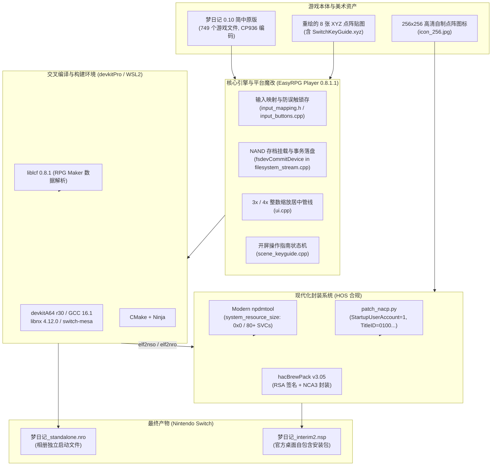

# 《梦日记》(Yume Nikki) Nintendo Switch 移植项目·核心接手与全景开发文档

> **文档性质**：项目交接 / 快速上手 / 架构设计与工程维护全景指南 (Handover & Engineering Guide)  
> **面向对象**：后续接手本项目的 AI 对话会话、人类开发者与维护者  
> **当前版本**：v1.2.1 (WenQuanYi 12px Pixel Bezel, YNO Purple Theme, Tight Bracket Notation & Aligned Opening Guide)  
> **维护状态**：已集成 Steam 官方原版底包与 ynoproject 20 种多语言本地化体系，全面重构 1:1 独立动作按键映射，开屏按键提示图转为原生地图事件驱动，新增 640×360 原生像素级边框与 ZL 键按住显隐管线，处于生产就绪稳定期  

---

## 目录 (Table of Contents)

1. [项目概览与交付物速查 (Executive Summary)](#1-项目概览与交付物速查-executive-summary)
2. [项目全景架构与技术栈 (System Architecture & Tech Stack)](#2-项目全景架构与技术栈-system-architecture--tech-stack)
3. [六大核心定制机制深度解析 (Deep-Dive into Custom Features)](#3-六大核心定制机制深度解析-deep-dive-into-custom-features)
   - [3.1 官方机身 NAND 账户独立存档体系（方案 A / 零 SD 污染）](#31-官方机身-nand-账户独立存档体系方案-a--零-sd-污染)
   - [3.2 Switch 掌机手柄按键体系与双向防误触锁存架构](#32-switch-掌机手柄按键体系与双向防误触锁存架构)
   - [3.3 原生等比整数点阵缩放与纯黑填充管线](#33-原生等比整数点阵缩放与纯黑填充管线)
   - [3.4 全量点阵美术与开屏操作指南贴图重绘](#34-全量点阵美术与开屏操作指南贴图重绘)
   - [3.5 Switch 原生主机语言识别与主页面多语言动态切换体系](#35-switch-原生主机语言识别与主页面多语言动态切换体系)
   - [3.6 16:9 原生像素级边框与 ZL 键按住显隐管线 (Push-to-Show Bezel Overlay)](#36-169-原生像素级边框与-zl-键按住显隐管线-push-to-show-bezel-overlay)
4. [工作区目录全景与文件整理索引 (Workspace Tour)](#4-工作区目录全景与文件整理索引-workspace-tour)
5. [完整构建、测试与打包流水线 (Build & Packaging Pipeline)](#5-完整构建测试与打包流水线-build--packaging-pipeline)
   - [5.1 基础环境准备](#51-基础环境准备)
   - [5.2 一键构建流水线 (build_nsp_v3.sh)](#52-一键构建流水线-build_nsp_v3sh)
   - [5.3 单元测试运行方法](#53-单元测试运行方法)
   - [5.4 补丁更新与维护规范](#54-补丁更新与维护规范)
6. [排错指南与已知陷阱 (Troubleshooting & Known Pitfalls)](#6-排错指南与已知陷阱-troubleshooting--known-pitfalls)
7. [后续接手开发者 / AI 会话行动清单与核心工程准则 (Developer Action Checklist & Principles)](#7-后续接手开发者--ai-会话行动清单与核心工程准则-developer-action-checklist--principles)
   - [7.1 核心工程准则：改动严格可逆性与版本号自然演进机制](#71-核心工程准则改动严格可逆性与版本号自然演进机制)
   - [7.2 后续开发行动清单](#72-后续开发行动清单)

---

## 1. 项目概览与交付物速查 (Executive Summary)

### 1.1 项目定位
本项目是将 RPG Maker 2003 殿堂级独立游戏**《梦日记》（Yume Nikki Steam 官方正版底包）**深度原生移植到 **Nintendo Switch (HOS 18/19/20+ / Atmosphère)** 平台的自包含多语言移植工程。

本项目在源码层深度定制开源解释器 **EasyRPG Player 0.8.1.1**，打造了**具有官方商业游戏同等交互品质**的独立 NSP：
- 规范的标准商业段 Title ID（`0100A1B2C3D40000`）。
- 启动时自动拉起 Switch 官方“由谁游玩？”账户选择器。
- 游戏存档与配置全量走机身 NAND 加密存档分区（`save:/`），带事务日志提交保护，不向 SD 卡产生任何脏文件。
- 原生 3× / 4× 绝对等比整数点阵居中缩放，纯正像素观感。
- 完备的手柄防误触锁存机制与全量重绘的原生点阵手柄教学贴图。
- **v1.1.0 全量多语言支持**：基于 `ynoproject/ynotranslations` 提供 20 种语言本地化支持，首次启动原生自动探测 Switch 主机系统语言；主页面常驻语言切换选项，切换实时生效并固化至 NAND。
- **v1.2.0/v1.2.1 16:9 原生像素级周边边框**：640×360 画布最近邻 2×/3× 缩放自适应掌机与底座，采用文泉驿 12px 原生点阵字形与 YNOproject Theme 9 紫色渐变风格，左右各 5 键紧凑排布与紧凑括号（`[A]`、`[摇杆]` 等），ZL 按键专属硬件级 Push-to-Show 显隐管线；同步精修开屏操作指南（`SwitchKeyGuide.xyz`）中的“ZL 键  键位提示”左右边界严格双向对齐。

### 1.2 核心交付产物速查

所有最终二进制构建产物均规范归档于 `dist/` 目录下：

| 文件名 | 大小 | SHA-256 校验和 | 交付定位与说明 |
|:---|:---|:---|:---|
| **`dist/梦日记_v1.2.1.nsp`** | 108.5 MB | `10235dcf1aa7c8d09f7fa5393d30669fd5011abe3d17c689c1e0001d352ec8bb` | **《梦日记》最新主力交付物**：1:1 独立按键 + 640×360 紫色渐变极简键位边框 + 紧凑括号包裹 + 开屏对齐精修 + ZL 按住显隐 + 多语言与机身 NAND 存档。 |
| **`dist/梦日记_v1.2.0.nsp`** | 108.5 MB | `ecbe6bbca9c2a4c67705eb1f8806d1d494ef9cab9c6e422df917893ab0faaa15` | v1.2.0 历史归档包（初版边框）。 |
| **`dist/梦日记_v1.1.2.nsp`** | 108.5 MB | `14a8d2cdd6846a4779d3364656c42397fdc9e9e7c4e6ad4febeb3bde911f4fc6` | 同步保留的历史稳定包（兼容旧版本引用）。 |
| **`dist/梦日记_standalone.nro`** | 113.0 MB | `1446a226f65e9d822398bd64e01ff6fb9cd98c4fb3bbafb7297ff26e6c0da824` | **独立免安装交付物**：嵌入最新边框渲染管线与点阵资源，放入 TF 卡 `/switch/` 直接启动。 |
| **`dist/ゆめ2っき_v0.129g.nsp`** | **6.80 GiB** | `8e6e60904a98a8b8197331ed9ad2328a5810361061feac5787022cf0fd696de5` | **《ゆめ2っき》主力交付物**：Title ID `0100B2B2C3D40000`，自包含全量 4520 地图与 1864 首曲目，集成 13 种多语言本地化字典。 |
| `dist/RELEASE_NOTES_v1.1.0_MULTILANG.md` | - | - | v1.1.0 多语言正式版发布说明与安装指引。 |
| `dist/梦日记-nx.zip` | 49.3 MB | - | 分发压缩归档包（内含 NSP 及说明）。 |
| `dist/RELEASE_NOTES_v1.0.0.md` | - | - | 正式版本发布说明与安装指引。 |

> [!TIP]
> **快速测试建议**：如果您要在实机或模拟器上测试，请直接安装 **`dist/梦日记_v1.2.1.nsp`**（或通过 DBI 的 MTP 模式拖拽到 Switch 的 `MicroSD install` 或 `NAND install`）。

---

## 2. 项目全景架构与技术栈 (System Architecture & Tech Stack)

### 2.1 系统架构图



### 2.2 核心技术组件选型与版本

| 组件 | 版本 | 说明 |
|:---|:---|:---|
| **游戏宿主** | RPG Maker 2003 1.0.9.1 | 《梦日记》0.10 简体中文版，文本字符集为 CP936 / GBK，自带完整素材无需外部 RTP |
| **移植引擎** | EasyRPG Player 0.8.1.1 | 开源 RPG Maker 解释器，应用了本项目定制的 37KB 补丁包 |
| **数据库** | liblcf 0.8.1 | 解析 `.ldb`、`.lmt`、`.lmu` 格式的核心库 |
| **交叉编译器** | devkitA64 r30 (GCC 16.1.0) | devkitPro 官方 64 位 ARM 工具链 |
| **Switch 核心库** | libnx 4.12.0 | Nintendo Switch 官方自制软件核心接口库 |
| **图形/渲染库** | switch-mesa 20.1.0 / glad 0.1.27 | 硬件加速渲染管线（EGL / OpenGL） |
| **音频后端** | mpg123 + dr_wav + FmMidi | 覆盖原版 8 个 MP3、49 个 WAV 与 8 个 MIDI |
| **NSP 封装器** | hacBrewPack v3.05 | 替代了旧版 Nro2Nsp 的旧工具，提供完整的 RSA 配对签名与 modern NCA 封装 |

---

## 3. 四大核心定制机制深度解析 (Deep-Dive into Custom Features)

### 3.1 官方机身 NAND 账户独立存档体系（方案 A / 零 SD 污染）

#### 3.1.1 为什么必须采用官方 NAND 方案？
在早期版本或常规移植中，游戏通常把存档写在 SD 卡（例如 `sdmc:/switch/yumenikki-nx/save/`）。这种方式有严重缺陷：
1. **多用户混淆**：Switch 主机上多个玩家档案会共用同一套存档文件，互相覆盖。
2. **SD 卡文件碎片与拔卡风险**：玩家拔出 SD 卡在电脑读取时可能误删存档。
3. **系统无法统一管理**：在 Switch 的“系统设置 -> 数据管理 -> 管理保存数据”中看不到该游戏的存档大小，也无法使用系统自带的数据清除与云备份机制。

#### 3.1.2 实现细节与代码注入点

1. **强制拉起系统账户选择器 (`patch_nacp.py`)**：
   在打包生成的 `control.nacp` 中，配置以下属性：
   - `StartupUserAccount = 1 (Required)`：每次在 Switch 桌面启动游戏时，OS 强制弹出“由谁游玩？”头像选择界面。
   - `SaveDataOwnerId = 0x0100A1B2C3D40000`
   - `UserAccountSaveDataSize = 16 MiB`，`UserAccountSaveDataJournalSize = 16 MiB`（配额上限各 32 MiB）。
2. **挂载机身 NAND 存档分区 (`src/platform/switch/main.cpp`)**：
   使用 libnx 的 `fsMount_SaveData(&save_fs, title_id, user_id)` 将当前所选用户的 NAND 专属存档容器挂载为虚存设备 `"save"`（路径即为 `save:/`）。
3. **关键：事务日志提交机制 (`fsdevCommitDevice("save")`)**：
   > [!IMPORTANT]
   > Switch 的机身 NAND 存档采用了严格的日志型事务文件系统（Journaled Filesystem）。**在关闭文件句柄（fclose）后，数据仅仅写入了内存缓冲区，如果不显式调用 `fsdevCommitDevice("save")`，一旦游戏异常退出或玩家按 HOME 键强制关闭软件，所有修改将直接回滚丢弃！**

   本项目在以下三处核心节点注入了强制提交逻辑：
   - **`src/filesystem_stream.cpp`**：在 `Filesystem_Stream::OutputStream::Close()` 析构关闭文件流时，自动检查并执行 `fsdevCommitDevice("save")`。这意味着每次游戏写日记保存、修改配置文件落盘后，立即硬提交到 NAND！
   - **`src/scene_save.cpp`**：保存界面写完存档后额外提交一次。
   - **`src/scene_settings.cpp`**：修改音量或渲染配置后提交。
   - **`src/platform/switch/main.cpp`**：在主程序收到退出信号时统一提交并安全卸载设备。
4. **彻底关闭 SD 日志写入 (`src/game_config.cpp`)**：
   Switch 平台默认设置 `log_enabled = false`，禁止生成日志文件，确保零 SD 写入，彻底消除 SD 卡依赖。

---

### 3.2 Switch 掌机手柄按键体系与双向防误触锁存架构

#### 3.2.1 物理手柄按键映射表

《梦日记》原版在 PC 上依赖键盘的 `ENTER`、`ESC`、`1`、`3`、`5`、`9` 等按键。针对 Switch 掌机及 Pro 手柄，定制了完全符合现代主机习惯的独立直觉映射布局：

| Switch 手柄按键 | 原作键位 | 映射游戏动作 | 逻辑说明与操作场景 |
|:---|:---|:---|:---|
| **左摇杆 / 十字键** | 方向键 | 移动 / 光标导航 | 控制附子上下左右移动与菜单选择 |
| **A 键** | ENTER / Z | **互动 / 决定 (`DECISION`)** | 调查房间家具、对话、书桌写日记保存 |
| **B 键** | ESC / X | **菜单 / 取消 (`CANCEL`)** | 呼出/关闭梦境物品栏菜单、取消选择、退出小游戏 |
| **X 键** | 数字键 1 | **使用效果 / 坐下 (`N1`)** | 触发当前装备效果的主动动作（如开伞、红绿灯变色、骑车鸣笛、就地坐下等） |
| **Y 键** | 数字键 3 | **退出效果 (`N3`)** | 取消当前效果动作（如站起、收起动作等） |
| **L 键** | 数字键 5 | **丢下效果 (`N5`)** | 在门的房间（Nexus）内地毯上丢弃当前装备的效果道具 |
| **R 键** | 数字键 9 | **掐脸醒来 (`N9`)** | 掐附子的脸，从梦境脱离回到现实房间 |
| **Plus (+) 键** | - | **游戏加速 (`FAST_FORWARD_A`)** | 快进游戏探索节奏 |
| **ZR 键** | - | **游戏加速 (`FAST_FORWARD_A`)** | 备用快进键，按住后多倍速探索 |
| **Minus (-) 键** | - | **EasyRPG 系统设置菜单** | 调整全局音量、音频渲染器配置 |
| **ZL / 摇杆下压** | - | *已禁用* | 屏蔽无用按键，防止探索中误触 |

#### 3.2.2 双向防误触锁存算法 (`ModifierState`)

针对组合键（`L + A`、`L + B`）可能出现的“串键”问题（例如：想按 `L + A` 触发效果动作，结果误触发了 A 键的调查；或者松开时先松开了 L，导致误判定为单独按 A），在 `src/platform/switch/input_mapping.h` 中实现了精确的带状态锁存算法：

```cpp
struct ModifierState {
    // 释放 L 锁存：按住 L 时按下的 A/B，在松开 L 但未松开 A/B 时，继续抑制普通 A/B
    bool suppress_normal_a = false;
    bool suppress_normal_b = false;

    // 按下 L 锁存：在未按 L 时已按住的 A/B，后续若不小心按到了 L，抑制组合键 N1/N3
    bool suppress_chord_a = false;
    bool suppress_chord_b = false;
};
```

**锁存器工作流程：**
1. **防提前触发普通键**：只要 `L` 被按住，独立的 A 键和 B 键动作被硬屏蔽。
2. **防松手漏键（释放锁存）**：触发 `L + A` 后，若玩家先松开 `L` 手指尚未离开 `A`，系统检测到 `suppress_normal_a` 为 true，不会误触发 A 的调查动作；直到 A 键完全抬起，状态机才复位。
3. **防误碰组合键（按下锁存）**：如果玩家正在按住 A 调查对话，中途不小心按到了 L，系统检测到 `suppress_chord_a` 为 true，绝不会误触发 N1 技能。

该算法在 `tools/tests/test_input_mapping.cpp` 中拥有 100% 覆盖率的主机端单元测试。

---

### 3.3 原生等比整数点阵缩放与纯黑填充管线

#### 3.3.1 渲染原则
- **游戏原生分辨率**：320×240 (4:3 比例)。
- **掌机模式 (720p, 1280×720)**：采用严格 **3× 等比整数缩放（960×720）**，居中渲染。
- **底座模式 (1080p, 1920×1080)**：采用严格 **4× 等比整数缩放（1280×960）**，居中渲染。
- **背景填充**：四周填充纯黑色（#000000），消除一切拉伸模糊、锯齿插值形变。
- **锁定触屏面板**：移动端专用的虚拟数字键盘和触摸操控已在底层被硬编码禁用（`touch_ui = false`），保证画面的纯粹性。

---

### 3.4 全量点阵美术与开屏操作指南贴图重绘

为了让 Switch 玩家获得官方发售级别的沉浸感，本项目全量重绘了游戏内部包含的所有按键操作说明贴图（全部转换为 RPG Maker 原生 XYZ 调色板点阵格式）：

#### 3.4.1 重绘贴图清单表 (`work/patched_picture/` & `romfs/Language/zh/Picture/`)

| 贴图文件名 | 原始贴图作用 | 重绘内容与 Switch 实体按键适配 | 对应 Steam RomFS 数字文件名 |
|:---|:---|:---|:---|
| **`SwitchKeyGuide.xyz`** | **本项目新增** | **开屏专属操作指南**（Map0002 开场第一屏呈现，左右分栏点阵按键总览） | `SwitchKeyGuide.xyz` |
| `GameFlow.xyz` | 现实流程总览说明 | `捏自己的脸 (R 键)`（已手工精修对齐与欧式描边） | `000000000142.xyz` |
| `indream.xyz` | 梦境操作总览说明 | `调查 (A键)`、`门之房间丢弃 (L 键)`（已手工精修对齐与欧式描边） | `0000000138.xyz` |
| `FCgameflow.xyz` | FC 风格现实流程 | `捏自己的脸 (R 键)` 适配 FC 像素风格 | `00000000000049.xyz` |
| `FCindream.xyz` | FC 风格梦境操作 | `舍弃 (L 键)` 适配 FC 像素风格 | `000000000048.xyz` |
| `FamiGameIntro.xyz` | NASU 电视机小游戏介绍 | `⬅➡ 键 : 左右移动`、`A 键 : 跳跃` | `0000000000000000000149.xyz` |
| `[G]frame.xyz` | NASU 游戏主界面外边框 | 底部提示重绘为 `长按B键可以退出游戏` | `0000080.xyz` |
| `[G1]Title.xyz` | NASU 游戏标题画面 | 提示改为 `PUSH A` | `000000000000085.xyz` |

#### 3.4.2 字体与开局原生地图事件驱动机制 (Map0002.lmu EV0001)
- **不再使用 C++ 引擎强制注入 Scene_KeyGuide**：旧版通过 C++ 插入 `Scene_KeyGuide` 会绕过原版游戏状态机，现全面改为**直接修补 RPG Maker 原版地图事件**（`Map0002.lmu` 事件 EV0001 第 1 页）。
- **Steam Playism 原版资产数字映射保持**：
  - 核心排错关键：Steam 原版底层使用数字文件名（如 `000000000142` 为 GameFlow、`0000000078` 为附窗子 `heroin_001` 行走图）。修补事件时**严禁使用旧第三方汉化包的英文名**，必须严格基于 `Map0002_steam_orig.emu` 修补，并在多语言层写入对应数字名的 `.xyz` 文件，保证附窗子精灵图完整显示。
- **防止开屏画面循环回弹（KeyInputProc 摇杆过滤）**：
  - 原版 `KeyInputProc`（11610 指令）若开启了方向键监听（`param[2]=1`），当摇杆漂移或玩家误碰方向键时会返回 1~4，导致条件分歧失败退出子调用，从而被 Page 1 的 AutoRun 触发死循环重新淡入淡出。
  - 修补事件时将 Page 1 改为监听 A/B/X/Y/L/R（`param[2]=0` 屏蔽摇杆，条件分歧为 `Var[2] >= 1`）；Page 2~4 同样将 `param[2]` 设为 0，彻底根除开屏循环与误跳。
- **开局总览图美术工艺**：
  - 用户采用 Aseprite 手工完成版面平衡设计与文泉驿 9pt 点阵文字排版，核心文字色 `#fccee4`，内层 1px 描边 `#240a1c`，外层 1px 描边 `#644664`，背景严格锁定 `#040204`，调色板第 0 项保留为透明色键（`#e40404`），杜绝黑底变透明。

---

### 3.5 Switch 原生主机语言识别与主页面多语言动态切换体系

#### 3.5.1 多语言架构设计
本项目从 v1.1.0 起全面基于 Steam 原版底包（Playism 英日双语基底）配合 `ynoproject/ynotranslations` 的 20 种语言本地化资源构建：
1. **Switch 系统语言原生探测 (`GetSwitchHostLanguage`)**：
   在 `src/platform/switch/main.cpp` 中通过 libnx 调用 `setGetSystemLanguage()` 与 `setMakeLanguage()`，在启动时原生匹配当前 Switch 系统语言代码：
   - `SetLanguage_ZHCN` / `SetLanguage_ZHHANS` -> `zh` (简体中文)
   - `SetLanguage_JA` -> `ja` (日本語)
   - `SetLanguage_ZHTW` / `SetLanguage_ZHHANT` -> `zh_tr` (繁體中文)
   - `SetLanguage_KO` -> `ko` (한국어)
   - `SetLanguage_FR` / `FRCA` -> `fr` (Français)
   - `SetLanguage_DE` -> `de` (Deutsch)
   - `SetLanguage_IT` -> `it` (Italiano)
   - `SetLanguage_ES` / `ES419` -> `es` (Español)
   - `SetLanguage_RU` -> `ru` (Русский)
   - `SetLanguage_PT` / `PTBR` -> `pt_br` (Português)
   - `SetLanguage_ENUS` / `ENGB` -> `default` (English)
   首次无存档/无自定义语言配置时，游戏直接以此母语进入主界面，彻底消除冗余弹窗。
2. **主标题页面（`Scene_Title`）自由切换**：
   主页面固定呈现语言选项（动态显示为 `语言` / `Language` / `言語` 等）。玩家选择后进入 `Scene_Language` 列表切换，切换后主页面文字立即实时刷新。
3. **NAND 事务级持久化**：
   在 `src/game_config.h` 中新增 `language` 配置项。玩家在菜单中一旦切换语言，立即通过 `Game_Config::WriteToStream` 保存至 `save:/easyrpg.ini`，并硬提交至机身 NAND，下次启动优先使用该选择。

---

### 3.6 16:9 原生像素级边框与 ZL 键按住显隐管线 (Push-to-Show Bezel Overlay)

#### 3.6.1 为什么必须以 640×360 作为基准创作边框？
由于 Switch 屏幕物理比例为 16:9，而《梦日记》原版游戏是 4:3 比例（原版 320×240，等比扩放至垂直满高即为 **480 : 360**）：
- **640 × 360** 是 Nintendo Switch 掌机模式（1280×720，正好 **2×**）与主机底座模式（1920×1080，正好 **3×**）在 16:9 标准下的**最大公约整数分辨率**。
- 在 640×360 画布上：
  - 中央 **480 × 360 (4:3)** 区域保留为 100% 透明的游戏呈现视口（`[80, 560)`）。
  - **左侧展示栏**：`[0, 80)`（宽度 80 px，展示点阵插画与氛围装饰）。
  - **右侧展示栏**：`[560, 640)`（宽度 80 px，展示手柄按键速查指南）。
- 缩放实效：
  - **掌机模式 (720p)**：经 GPU 最近邻 2× 放大后，左右各 160 px 边框，中间 960 × 720。与 EasyRPG 引擎原版 320×240 的 3× 整数缩放（960×720，留空 160 px 黑边）**完全 0 像素缝隙对齐**！
  - **底座模式 (1080p)**：经 GPU 最近邻 3× 放大后，左右各 240 px 边框，中间 1440 × 1080，在电视大屏上同样保持严谨清晰的像素方块。

#### 3.6.2 YNOproject 紫色渐变调色风格与文泉驿 12px 原生点阵 (v1.2.1 精修)
严格对标 [YNOproject (Yume Nikki Online)](https://ynoproject.net/yume/) 提取的经典 UI 调色规范与点阵排版准则：
1. **字体字形与完美 1-bit 二进制渲染**：
   - 彻底舍弃易产生抗锯齿发糊的矢量/部分缩小位图，改用原生 12px 规格的 **文泉驿点阵宋体**（`wenquanyi_9pt.pcf`）。
   - 字形在 12×12 像素网格内纯粹为 0/1 二值化映射，笔画横平竖直、内部留白透彻，彻底杜绝小号字体笔画粘连成团的缺陷。
2. **YNOproject Theme 9 梦幻紫色渐变工艺**：
   - 提取自官方 YNOproject 样式表：起始高亮紫 `rgb(217, 179, 228)` (`#D9B3E4`) 线性向下渐变至深邃紫 `rgb(137, 87, 131)` (`#895783`)。
   - 配合 1px 经典外描边，与游戏原版界面与梦境氛围浑然天成。
3. **极简 10 键左右对称纯净排布**：
   - 左右边框彻底剥除冗余插画与装饰框线，仅专注于直观的按键提示。
   - **紧凑括号包裹样式**：按键名称紧凑包裹，如 `[A]`、`[摇杆]`、`[ZL]`，消除字符与括号间的冗余空隙。
   - **紧凑段落跨度与垂直居中**：按键名与动作说明行间距设为 1px，单项按键垂直跨度为 48px，左右各 5 组按键以 Y=180 屏幕几何中心绝对居中（中心点分别位于 Y = 84, 132, 180, 228, 276）：
     - **左侧展示栏 `[0, 80)`**：`[摇杆] 角色移动`、`[A] 交互`、`[B] 菜单·取消`、`[X] 使用效果`、`[Y] 退出效果`。
     - **右侧展示栏 `[560, 640)`**：`[L] 丢下效果`、`[R] 掐脸醒来`、`[+] 游戏加速`、`[-] 系统设置`、`[ZL] 显示边框`。
4. **开屏操作指南贴图（`SwitchKeyGuide.xyz`）双向边界完美像素对齐**：
   - 开屏引导图同步精修：将原第 5 行“ZR 备用加速”替换为“ZL 键  键位提示”。
   - 以原版“Z”字首字母 X=179 为严格物理对齐基准，“键位提示”右侧结束位置精确对齐至 X=257。
   - 与第 4 行“R 键  掐脸醒来”（X=179 开始，X=257 结束）在视觉上达成像素级完美的左右双向边缘对齐。

#### 3.6.3 ZL 按键专属 Push-to-Show 硬件渲染管线与防冲突解耦
1. **实时采样检测 (`src/platform/switch/ui.cpp`)**：
   在 `NxUi::ProcessEvents()` 中实时提取 `padGetButtons(&pad)`，更新状态 `show_bezel = (input & HidNpadButton_ZL) != 0`。
   - **按住 ZL 键**：进入显隐分支，GPU 硬件纹理通道 0 绘制 16:9 全屏边框，通道 1 居中绘制 4:3 游戏主画面（横向坐标缩放比 `aspectX = 0.75f`，完美契合 480:360）。
   - **松开 ZL 键**：边框跳过绘制，恢复原始纯黑填充（#000000），游戏画面保持等比整数点阵缩放居中，绝不干扰沉浸式探索。
2. **逻辑冲突解耦 (`src/platform/switch/input_mapping.h`)**：
   将 `keys[Input::Keys::JOY_LTRIGGER_FULL]` 硬屏蔽为 `false`，彻底隔离 ZL 键，确保玩家在按住 ZL 随时查看边框与按键时，绝不触发游戏内的任何不可预期操作。
3. **C++ 静态嵌入二进制 (`bezel_png.h`)**：
   通过 `tools/bin2h.py` 将经过像素检验的 `work/bezel/bezel_base_640x360.png` 编译前直接转为 C 数组嵌入二进制，无需 RomFS 外部 IO 读取延迟，瞬时即现。

---

## 4. 工作区目录全景与文件整理索引 (Workspace Tour)

工作区核心根目录为 `d:\YumeNikki-Nx\`，内部组织清晰严整：

```text
d:\YumeNikki-Nx\
├── HANDOVER.md                                 # 本接手文档 (全局核心引导)
├── README.md                                   # 项目主说明文档 (含特性、按键与安装指引)
├── .gitignore                                  # 生产级 Git 忽略规则 (过滤 Keys、构建中间物与大包)
├── keys/
│   └── prod.keys                               # Switch 官方打包密钥 (用于本地 hacBrewPack 签名，严禁上传公网)
├── patches/
│   └── easyrpg-player-yumenikki-nx.patch       # EasyRPG 0.8.1.1 完整定制补丁 (37KB)
├── tools/
│   ├── build_nsp_v3.sh                         # 主力自动化全流程构建与打包脚本 (一键编译+生成 NSP/NRO)
│   ├── build_npdm.py                           # HOS 20+ 合规的 NPDM JSON 描述符构建脚本
│   ├── patch_nacp.py                           # NACP 官方机身 NAND 账户存档属性修补工具
│   ├── test_npdm.py                            # NPDM 静态格式验证辅助脚本
│   ├── build_v2.sh                             # 历史版本打包脚本 (供参考)
│   ├── tests/
│   │   └── test_input_mapping.cpp              # SwitchInput::ApplyPad 双向锁存防误触单元测试
│   └── Nro2Nsp-master/                         # 历史早期打包工具包 (已退役，保留备查)
├── docs/
│   ├── 对话记录导出.md                           # 历史技术决策与问题攻坚完整时间线记录
│   └── Nintendo Switch Homebrew...指南.md       # 早期移植技术路线调研与可行性分析报告
├── dist/                                       # 编译构建输出归档目录
│   ├── 梦日记_interim2.nsp                      # 最新 Release NSP (推荐安装)
│   ├── 梦日记_standalone.nro                    # 最新 Release 独立免安装 NRO
│   ├── 梦日记_interim1.nsp                      # 历史 Interim1 测试包
│   ├── 梦日记-nx.zip                            # 发布分发压缩包
│   ├── RELEASE_NOTES_v1.0.0.md                 # v1.0.0 发布说明
│   ├── README_interim1.md                      # Interim1 测试指引与冒烟清单
│   └── README_interim2.md                      # Interim2 修复项与安装说明
├── work/                                       # 工作暂存与源码定制区
│   ├── icon_256.jpg                            # 256x256 高清点阵游戏图标
│   ├── patched_picture/                        # 重绘后的 8 张 Switch 专用 XYZ 贴图资产
│   ├── src/                                    # 修改后的 EasyRPG Player 与 liblcf 源码副本 (用于生成 patch)
│   └── game/                                   # staged 游戏文件副本
├── build/                                      # 桌面端调试脚本与中间文件
│   ├── env.sh                                  # 环境变量配置
│   ├── run_host_test.sh                        # Linux 桌面端 Xvfb 自动化运行测试脚本
│   └── source-manifest.csv                     # 游戏 749 个文件的校验清单表
├── vendor/                                     # 上游干净源码包解压目录 (用于 git diff 校验)
│   ├── easyrpg-player-0.8.1.1/
│   └── liblcf-0.8.1/
└── yumenikki0.10chs/                           # 梦日记 0.10 简体中文版原始游戏未修改根资产
```

---

## 5. 完整构建、测试与打包流水线 (Build & Packaging Pipeline)

### 5.1 基础环境准备

本项目采用 **Windows 宿主机 + WSL2 (Ubuntu 24.04 LTS)** 的混合协同模式：
- **代码与资产存放**：Windows 文件系统 `D:\YumeNikki-Nx`（在 WSL2 中自动映射为 `/mnt/d/YumeNikki-Nx`）。
- **工具链配置（WSL2 内）**：
  - `/opt/devkitpro`（devkitPro 官方工具链，包含 `devkitA64`、`libnx`、`switch-tools`、`switch-mesa` 等）。
  - `/opt/easyrpg-switch`（已预编译好供 Switch 链接的 ICU、liblcf、fmt、mpg123、dr_wav 静态库）。
  - 打包工具：`/home/ubuntu/yn-build/tools/hacbrewpack_src/hacBrewPack-master/hacbrewpack`。

### 5.2 一键构建流水线 (`build_nsp_v3.sh`)

整个编译、单测、打包和归档已经完全自动化。在 WSL2 或通过 PowerShell 执行以下命令即可完成全量构建：

```powershell
# 在 Windows PowerShell 中直接调用 WSL 构建《梦日记》：
wsl bash /mnt/d/YumeNikki-Nx/tools/build_nsp_v3.sh

# 在 Windows PowerShell 中直接调用 WSL 构建《ゆめ2っき》(Yume 2kki)：
wsl bash /mnt/d/YumeNikki-Nx/tools/build_yume2kki_nsp.sh
```

#### 流水线五个阶段的执行细节：

1. **`[0/5] 资产与源码同步 (Syncing assets & patching NACP)`**：
   - 将 `work/src/` 中的魔改源码同步到 WSL 构建目录。
   - 将 `work/patched_picture/*.xyz` 重绘贴图复制到 RomFS 的 `Picture/` 目录下。
   - 将 `work/icon_256.jpg` 分发到 AmericanEnglish、SimplifiedChinese、TraditionalChinese 控制图标槽位。
   - 执行 `patch_nacp.py`，向 `control.nacp` 注入 `StartupUserAccount = 1` 及 16MB NAND 存档配额。
2. **`[1/5] 主机端单测运行 (Running host unit tests)`**：
   - 自动编译并运行 `tools/tests/test_input_mapping.cpp`。
   - 验证 `SwitchInput::ApplyPad` 双向锁存防误触逻辑 100% 通过。
3. **`[2/5] 交叉编译引擎 (Compiling EasyRPG Player)`**：
   - 使用 Ninja 多核并发编译适用于 Switch AArch64 的 `easyrpg-player.elf`。
4. **`[3/5] 生成 ExeFS 与 NRO (Generating NSO & Standalone NRO)`**：
   - 使用 `elf2nso` 将 ELF 转换为 Switch 原生可执行文件 `main`。
   - 使用 `elf2nro` 生成嵌入完整 RomFS 的免安装版 `dist/梦日记_standalone.nro`。
5. **`[4/5] hacBrewPack 封装 NSP (Packaging NSP with hacBrewPack)`**：
   - 自动检测工作区 `keys/prod.keys`。
   - 由 `hacBrewPack v3.05` 执行 RSA 签名配对，生成合规 NCA3 容器（Program NCA + Control NCA + Meta CNMT NCA）。
   - 最终输出标准自包含安装包 `dist/梦日记_interim2.nsp`。
6. **`[5/5] 产物校验 (Verifying output artifacts)`**：
   - 打印输出文件体积并计算 SHA-256 校验和。

---

### 5.3 单元测试运行方法

如果仅想独立验证手柄防误触锁存逻辑，无需完整编译整个引擎：

```bash
# 在 WSL2 终端执行：
g++ -std=c++17 -DUSE_SDL=1 \
  -I/home/ubuntu/yn-build/vendor/easyrpg-player-0.8.1.1/src \
  -I/home/ubuntu/yn-build/vendor/liblcf-0.8.1/src \
  -I/opt/devkitpro/portlibs/switch/include \
  /mnt/d/YumeNikki-Nx/tools/tests/test_input_mapping.cpp \
  -o /tmp/test_input_mapping && /tmp/test_input_mapping
```

输出 `All SwitchInput::ApplyPad unit tests PASSED successfully!` 即表示通过。

---

### 5.4 补丁更新与维护规范

如果在 `work/src/easyrpg-player-0.8.1.1` 中对源码进行了新的改动，必须同步更新 `patches/easyrpg-player-yumenikki-nx.patch`：

```bash
# 在 WSL 中进入项目根目录：
cd /mnt/d/YumeNikki-Nx
diff -urN vendor/easyrpg-player-0.8.1.1 work/src/easyrpg-player-0.8.1.1 > patches/easyrpg-player-yumenikki-nx.patch
```

---

## 6. 排错指南与已知陷阱 (Troubleshooting & Known Pitfalls)

| 异常现象 / 错误信息 | 根本原因 (Root Cause) | 解决方案 (Solution) |
|:---|:---|:---|
| **Switch 桌面点击图标后提示“无法启动软件”** | 1. 使用了非标准的 Title ID（如早期 `05E0...` 会被部分 HOS 拦截）。<br>2. NPDM 缺少现代固件强制要求的 `system_resource_size: 0x0`。<br>3. 打包工具导出了全 0 的未签名 NCA 头部。 | 1. 确保 Title ID 位于官方 Application 范围（本项目使用 `0100A1B2C3D40000`）。<br>2. 运行 `tools/build_npdm.py` 生成合规 NPDM。<br>3. 必须使用 `hacBrewPack v3.05` 配对 `prod.keys` 打包。 |
| **实机玩完写日记，重启游戏后存档丢失/回档** | Switch 的 NAND 存档采用日志型文件系统，底层未执行事务提交。 | 确保 `src/filesystem_stream.cpp` 的 `Close()` 函数中调用了 `fsdevCommitDevice("save")`。已在当前补丁中修复。 |
| **开局连续弹出贴图缺失报错，且进房间附窗子隐形** | `Map0002.lmu` 误用了旧汉化包的英文素材名，而 Steam 原版 RomFS 与 `ynotranslations` 采用日文数字编码（附窗子行走图为 `0000000078`）。 | 严禁使用英文资产名修补事件；必须使用 `tools/patch_map0002_xml.py` 基于 `Map0002_steam_orig.emu` 编译生成，保持所有数字文件名引用。 |
| **开局画面（黑屏/Logo/操作图）重复循环播放 3~4 次** | 原版 `KeyInputProc`（11610）监听了方向键（`param[2]=1`），摇杆微小输入导致条件分歧失败跳出调用链，被 Page 1 的 AutoRun 重新触发。 | 在 `Map0002.lmu` EV0001 的各页中将 `KeyInputProc` 的 `param[2]` 设为 0（关闭摇杆/方向监听），Page 1 分歧设为 `Var[2] >= 1`，彻底根除循环。 |
| **开屏或教学贴图黑色背景变透明/镂空** | RPG Maker 的 `11110` 指令若启用透明色，底层会将调色板 index 0 当作透明。若转换 PNG 时直接取黑底作为 index 0，黑色即变透明。 | 转换 `.xyz` 时必须保留透明色键（如 `#e40404`）作为 index 0，实际黑底 `#040204` 作为 index 1。已固化在 `tools/apply_user_modifications.py`。 |
| **中文剧情或菜单显示为问号或乱码** | 旧版 EasyRPG 默认根据系统区域探测编码，误识别为 Shift-JIS (日文) 或 Latin-1。 | v1.1.0 多语言版已全面迁移至 Steam 原版 + `ynotranslations` UTF-8 架构，底层由 `libnx` 自动侦测主机语言或在主菜单选择语言。 |
| **阿拉伯语 (ar) 或希伯来语 (he) 显示方块/问号/乱码** | Switch 交叉编译工具链未开启 FreeType 与 HarfBuzz，降级至无阿文/希伯来文字符的内置点阵字体，且缺少 BiDi 复杂排版。 | 在 `/opt/easyrpg-switch/lib/pkgconfig/*.pc` 中修正 Jenkins 构建前缀，CMake 增加 `-DPLAYER_WITH_FREETYPE=ON -DPLAYER_WITH_HARFBUZZ=ON`，已在 `tools/build_nsp_v3.sh` 中固化。 |
| **执行 `build_nsp_v3.sh` 报找未找到 `prod.keys`** | 本地缺失 Switch 密钥文件。 | 将您的 Switch 提取密钥命名为 `prod.keys` 放置在 `d:\YumeNikki-Nx\keys\prod.keys`（已被 `.gitignore` 保护，不会被提交）。 |
| **安装后启动黑屏卡死** | RomFS 路径映射异常或缺失 `RPG_RT.lmt` 文件。 | 检查 `package_v2/romfs` 结构是否完整，确保 `RPG_RT.ldb`、`RPG_RT.lmt`、`RPG_RT.ini` 直接位于 RomFS 根目录。 |

---

## 7. 后续接手开发者 / AI 会话行动清单与核心工程准则 (Developer Action Checklist & Principles)

### 7.1 核心工程准则：改动严格可逆性与版本号自然演进机制

> [!IMPORTANT]
> **后续所有接手本项目的开发者与 AI 会话必须绝对恪守以下两条基本准则：**

#### 准则一：所有改动必须严格可逆 (Strict Reversibility Principle)
1. **源码与引擎层**：
   - 上游官方纯净源码目录（`vendor/easyrpg-player-0.8.1.1`、`vendor/liblcf-0.8.1`）必须保持洁净只读。
   - 所有引擎修改必须在 `work/src/` 中进行，并随时能够通过 `diff -urN` 重新生成补丁文件 `patches/easyrpg-player-yumenikki-nx.patch`。
   - 任何改动均可通过 `patch -R` 或 Git 历史实现完全无损撤销，严禁在项目中引入单向不可逆的代码污染。
2. **游戏资产与事件层**：
   - 官方原始未修改资产（`yumenikki0.10chs/`）与原始地图备份（`Map0002_steam_orig.lmu`）保持绝对只读。
   - 任何资产替换必须保留原版对应的备份，并提供自动化生成/还原脚本（如 `tools/generate_bezel_canvas.py`、`tools/patch_map0002_xml.py`）。
3. **功能交互层**：
   - 新增的 UI 覆盖层（如 16:9 像素边框）必须具备即时显隐（如 ZL 按住 Push-to-Show）或菜单开关，默认绝不强行破坏原版 4:3 纯黑留白的经典意境。

#### 准则二：版本号视改动幅度大小自然更新 (Semantic Versioning & Scope-Driven Bumping)
严禁频繁随意乱跳版本，亦不可累积重大改动而不升版本。必须严格遵循改动幅度自然演进：
1. **PATCH 修订号升级（`x.y.Z`）**：
   - **适用场景**：修复小缺陷、文案拼写微调、单张贴图优化、编译脚本路径修正。
   - **典型案例**：`v1.1.1` -> `v1.1.2`（开屏按键教学图转为地图事件驱动，修复循环播放与附窗子隐形 Bug）。
2. **MINOR 次版本号升级（`x.Y.0`）**：
   - **适用场景**：新增独立功能模块、交互管线大幅扩展、重大按键架构调整，但保持底包向前兼容。
   - **典型案例**：`v1.0.0` -> `v1.1.0`（引入 20 种多语言本地化体系）；`v1.1.2` -> `v1.2.0`（新增 640×360 原生像素边框与 ZL 键 Push-to-Show 硬件渲染管线）。
3. **MAJOR 主版本号升级（`X.0.0`）**：
   - **适用场景**：发生重大架构颠覆、更换游戏底包、或存档数据结构发生不可向后兼容的变化。
   - **典型案例**：`v1.0.0`（彻底抛弃 RetroArch / Nro2Nsp 简易 Forwarder，全面升级为自包含机身 NAND 商业级独立 NSP）。
4. **版本同步清单**：
   每次版本号自然提升时，必须同步更新：
   - `HANDOVER.md` 与 `README.md` 中的当前版本号与更新说明。
   - `tools/patch_nacp.py` 中的 `DisplayVersion`（确保 Switch 系统桌面信息卡显示最新版本号）。
   - `tools/build_nsp_v3.sh` 中的产物输出名（`dist/梦日记_vX.Y.Z.nsp`）。

---

### 7.2 后续开发行动清单

如果您是新开启的会话或刚刚接手该项目的开发者，请遵循以下原则：

1. **如需修改游戏资产（如更换音乐、增加彩蛋地图、改动事件）**：
   - 游戏原素材位于 `yumenikki0.10chs/梦日记/Yumenikki0.10/`。
   - 修改后同步到 `work/game/`。
   - 运行 `bash tools/build_nsp_v3.sh` 重新打包。
2. **如需重绘其他说明贴图或边框**：
   - 必须遵循 1-bit Mono 丁卯点阵体或文泉驿点阵字形，以及 YNOproject 三色描边工艺。
   - 边框修改请使用 `tools/generate_bezel_canvas.py` 重新生成并在 640×360 画布上核验，随后执行 `tools/bin2h.py` 更新头文件。
3. **如需增删按键逻辑**：
   - 直接修改 `work/src/easyrpg-player-0.8.1.1/src/platform/switch/input_mapping.h`。
   - 更新 `tools/tests/test_input_mapping.cpp` 对应的测试用例并跑通。
   - 执行 `diff -urN` 更新 `patches/easyrpg-player-yumenikki-nx.patch`。
4. **安全与发布禁忌**：
   - **绝对不要将 `keys/prod.keys` 提交到公开 Git 仓库**。
   - **不要在 Switch 运行时随意打开针对 SD 卡的频繁写日志操作**，以免影响 NAND 事务性能。
   - **绝对不要将 `keys/prod.keys` 提交到公开 Git 仓库**。
   - **不要在 Switch 运行时随意打开针对 SD 卡的频繁写日志操作**，以免影响 NAND 事务性能。
